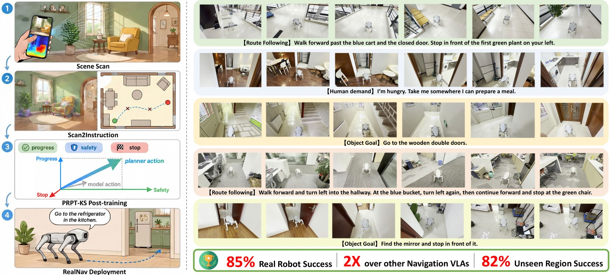

<h1 align="center">One Scan is Enough</h1>

<p align="center">Code for <i>One Scan is Enough: Demonstration-Free Adaptation for Language-Guided Navigation</i> (NeurIPS 2026).</p>

<p align="center">
  <a href="https://one-scan-is-enough.github.io/"></a>
  <a href="https://arxiv.org/abs/2610.33794"></a>
  <a href="https://huggingface.co/datasets/dynamica/one-scan-is-enough-demo-apartment"></a>
  <a href="https://huggingface.co/dynamica/RealNav-Base"></a>
</p>

<p align="center">
  <a href="https://one-scan-is-enough.github.io/"></a>
</p>

A brief handheld RGB-D scan of a building is enough to adapt a language-guided navigation policy to it, with no demonstrations and no human labels. The code has three parts:

- **Scan2Instruction** compiles the scan into navigation episodes. It reconstructs a Gaussian scene, plans collision-aware reference trajectories on a top-down free-space map, renders the views along them, and asks a multimodal language model for Route following, Object Goal, and Human Demand instructions.
- **RealNav** is a continuous-trajectory navigation VLA built on Qwen3-VL. Navigation tokens feed an MLP head that predicts eight local waypoints (x, y, θ).
- **PRPT-KS** (Pareto-utility Reinforcement Post-Training in Known Scenes) post-trains RealNav in the reconstructed scene. A Pareto utility of progress, safety, and stopping, read off the scene geometry, gives the policy-gradient advantage, decides when the planner replaces a policy action, and weights the preference pairs.

## Install the code

```bash
git clone --recurse-submodules https://github.com/DynamicCast03/one-scan-is-enough.git
cd one-scan-is-enough
pip install -e ".[rendering,instruction,posttrain,evaluation]"
pip install --no-build-isolation --no-deps --force-reinstall \
  "gsplat @ git+https://github.com/nerfstudio-project/gsplat.git@v1.5.3"
pip install --no-build-isolation flash-attn==2.7.4.post1
```

The code is tested with Python 3.10, PyTorch 2.6 with CUDA 12.4, transformers 4.57, gsplat 1.5.3, DeepSpeed 0.18, torchao 0.9, and flash-attn 2.7 on NVIDIA A100 80 GB GPUs. Installation needs a C++17 compiler.

one-scan-is-enough uses `opencv-contrib-python`, so uninstall `opencv-python` first when an environment already has it.

Scene reconstruction uses PGSR in `third_party/PGSR`. Build its two CUDA extensions:

```bash
pip install --no-build-isolation third_party/PGSR/submodules/diff-plane-rasterization third_party/PGSR/submodules/simple-knn
```

To run PGSR in a separate Python environment, set `pgsr.python` of `train-pgsr` to its interpreter, and set `pgsr.pythonpath` to the directory of the extensions when they are installed elsewhere.

Post-training starts from `realnav-base`, RealNav after pretraining on R2R-CE and RxR-CE. Download it from [dynamica/RealNav-Base](https://huggingface.co/dynamica/RealNav-Base):

```bash
hf download dynamica/RealNav-Base --local-dir <realnav-base>
```

## Adapt RealNav to your scene

Scan2Instruction turns a scan of your scene into a scene package, a directory with three files:

- `gaussians.ply` is the 3D Gaussian scene.
- `scene.h5` holds the ground alignment and the top-down navigable map.
- `trajectories.h5` holds the reference trajectories, the rendered images, the actions, and the instructions.

PRPT-KS then post-trains `realnav-base` on a training package, and a test package of the same scene measures the result.

### 1. Convert the capture

Scan the scene with the Stray Scanner app on an iPhone or iPad with LiDAR, or record it with a RealSense camera. Convert the recording to a TUM RGB-D directory:

```bash
convert-capture input.capture_dir=<capture> input.format=stray output.tum_dir=<tum>
```

For a RealSense recording, set `input.format=realsense`. The recording directory holds `rgb/<n>.jpg`, `depth/<n>.png` as 16-bit depth in millimeters aligned to the color camera, and `color_intrinsics.json` with `fx`, `fy`, `ppx`, `ppy`, `width`, and `height`, where `<n>` counts from 0.

### 2. Export PGSR inputs

```bash
export-pgsr input.tum_dir=<tum> input.poses=arkit output.scene_dir=<colmap>
```

`input.poses` selects the camera poses. `arkit` takes the ARKit poses of a Stray Scanner capture. `orbslam3` takes ORB-SLAM3 poses and works for both devices. RealSense recordings need it, since they have no poses of their own. For ORB-SLAM3 poses, run the RGB-D example of ORB-SLAM3 with `<tum>/tum.yaml` and `<tum>/association.txt`, and move the `CameraTrajectory.txt` it writes into `<tum>`.

### 3. Reconstruct the Gaussian scene

```bash
train-pgsr input.scene_dir=<colmap> output.model_dir=<model>
```

The run ends by printing the Gaussian file, `<model>/point_cloud/iteration_30000/point_cloud.ply`.

### 4. Prepare the scene

```bash
prepare-scene input.gaussian_ply=<model>/point_cloud/iteration_30000/point_cloud.ply \
  input.scene_name=<name> output.scene_dir=<scene>
```

`<name>` is a name of your choice for the scene. This aligns the ground and builds the top-down navigable map, with two manual steps in a browser. First rotate the map so that the walls align with the axes. Then confirm and edit the navigable area. The log prints the page address, `http://127.0.0.1:8765/` by default. On a remote server, forward the port from the local machine:

```bash
ssh -N -L 8765:127.0.0.1:8765 <server>
```

Then open the address locally and add `calibration.open_browser=false`. The output holds `scene.h5` and `gaussians.ply`.

### 5. Plan trajectories

```bash
plan-trajectories input.scene_dir=<scene> planning.num_trajectories=300
```

Trajectories go to `<scene>/trajectories.h5`. We recommend more trajectories (`planning.num_trajectories`) for a larger scene. For deployment on a real robot, we recommend a larger safety margin `clearance_m` than the default 0.15 m, set in `src/one_scan_is_enough/config/planning_map/default.yaml`. Reference paths, closed-loop runs and the post-training safety penalty all use this margin.

A scene directory holds one trajectory file, and planning fails if the file exists. For a test set, copy `scene.h5` and `gaussians.ply` to a new directory `<test-scene>` and plan there with another `seed`. Steps 6 and 7 then apply to both directories.

### 6. Render trajectories

```bash
render-trajectories input.scene_dir=<scene> "execution.gpus=[0]"
```

This renders the training observations, the route images, and the goal views shown to the language model into `trajectories.h5`.

### 7. Generate instructions

Instructions come from a multimodal language model behind an OpenAI-compatible endpoint, such as a hosted API or a local vLLM server. Fill `base_url` and `model` in `src/one_scan_is_enough/config/llm/default.yaml`, or pass them on the command line, and export the API key:

```bash
export ONE_SCAN_LLM_API_KEY=<key>
generate-instructions input.scene_dir=<scene> llm.backend.base_url=<url> llm.model=<model> \
  "instruction.types={vln:3,object:1,need:1}"
```

- Each trajectory gets one instruction type: `vln` (Route following), `object` (Object Goal: find a named object), or `need` (Human Demand: find what satisfies a stated need).
- `instruction.types` sets the shares of the types, equal by default. Set a share to zero to leave a type out.
- `llm/default.yaml` also sets the API style, image limits, and request concurrency.
- An interrupted run continues when started again. `instruction.relabel=true` labels all trajectories again.

### 8. Post-train RealNav with PRPT-KS

```bash
torchrun --standalone --nproc_per_node=<gpus> -m one_scan_is_enough.apps.posttrain_policy \
  scene_dir=<scene> \
  base=<realnav-base> \
  output_dir=<posttrain>
```

If GPU memory runs short, add `training.optimizer=adamw8bit`. With it, post-training fits on one A100 80 GB GPU. The model goes to `<posttrain>`.

### 9. Evaluate in the reconstructed scene

```bash
torchrun --standalone --nproc_per_node=4 -m one_scan_is_enough.apps.evaluate_policy \
  scene_dir=<test-scene> \
  checkpoint=<posttrain> \
  output_dir=<eval>
```

Processes can share one GPU. An episode succeeds when the final position lies within 1.5 m of the goal (`success_radius_m`).

Episode records go to `<eval>/episodes-*.jsonl`, and an interrupted run resumes from them. `<eval>/summary.json` holds the success rate (SR), SPL, navigation error (NE), and oracle success rate (OS), overall and per instruction type.

## Reproduce with Demo Apartment

To reproduce the paper's setting without a scan of your own, [dynamica/one-scan-is-enough-demo-apartment](https://huggingface.co/datasets/dynamica/one-scan-is-enough-demo-apartment) holds one scanned scene, Demo Apartment. Download it to `<demo>`:

```bash
hf download dynamica/one-scan-is-enough-demo-apartment --repo-type dataset --local-dir <demo>
```

It has the following layout:

```
<demo>/
|-- capture/demo_apartment/       Stray Scanner export of the scan
`-- datasets/
    |-- demo_apartment_train/     300 episodes for post-training
    `-- demo_apartment_test/      100 episodes for evaluation
```

Run step 8 with `scene_dir=<demo>/datasets/demo_apartment_train` and step 9 with `scene_dir=<demo>/datasets/demo_apartment_test`.

The training set has 180 Route following, 60 Object Goal, and 60 Human Demand episodes. To build a training set the same way from the raw scan, first extract the depth maps:

```bash
cd <demo>/capture/demo_apartment
tar -xf depth.tar
```

Then run steps 1 to 7 on `<demo>/capture/demo_apartment` with the commands above, and plan with `planning.num_trajectories=300 seed=8 execution.workers=10` in step 5.

## Citation

```bibtex
@inproceedings{yu2026onescan,
  title     = {One Scan is Enough: Demonstration-Free Adaptation for Language-Guided Navigation},
  author    = {Yu, Zhuoyuan and Long, Yuxing and Wang, Du and Wang, Junyang and Fan, Hongwei and Dong, Hao},
  booktitle = {Advances in Neural Information Processing Systems},
  year      = {2026}
}
```
